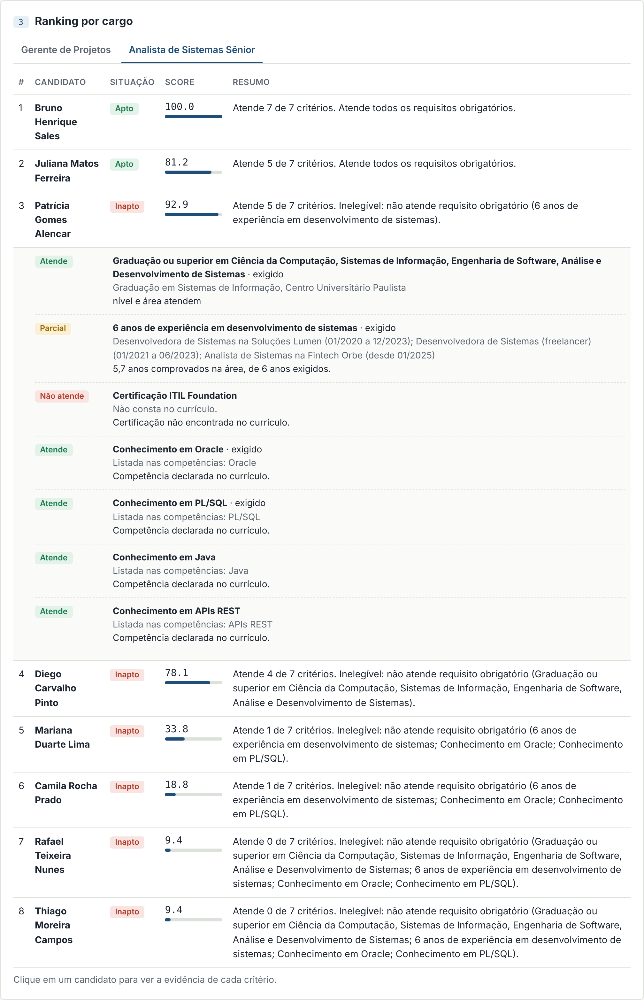
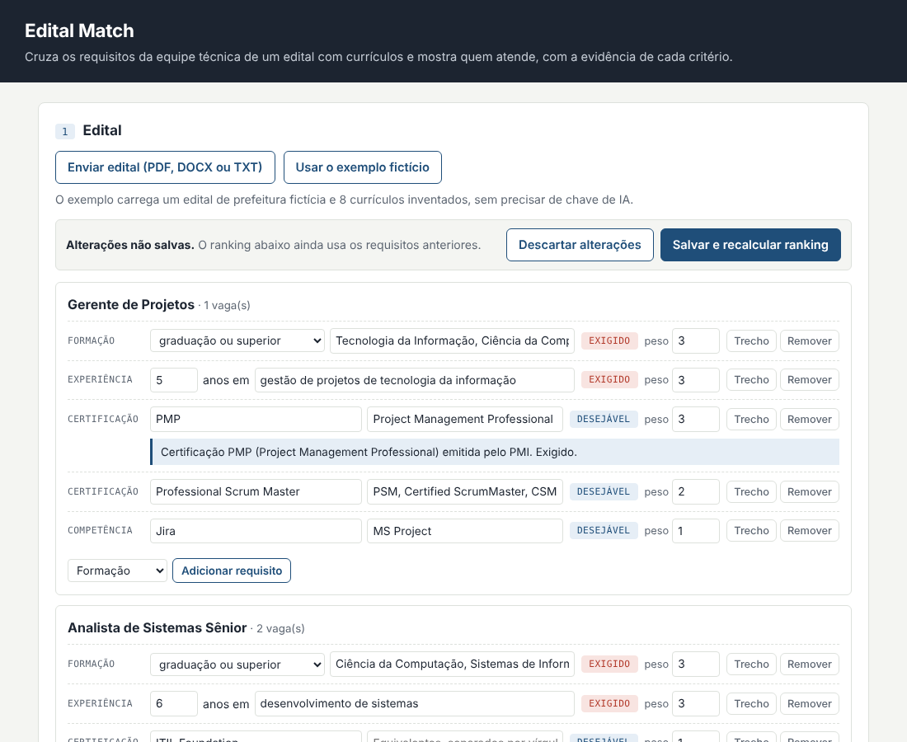

# Edital Match

Lê editais de licitação de TI com **RAG**, extrai os perfis e requisitos da equipe técnica com **página de origem** e mostra, para cada cargo, **a cobertura de cada profissional e as lacunas**, com a evidência de cada critério.

🔗 **Demo:** https://edital-match.onrender.com. Clique em **Usar o exemplo fictício** ou busque um edital público no PNCP. Está no plano gratuito do Render: depois de um tempo sem acesso, a primeira abertura leva cerca de 1 minuto.



## O problema

Em licitações de serviços de TI, o termo de referência descreve os perfis da equipe: formação, tempo de experiência, certificações e conhecimentos. Esses requisitos ficam espalhados num documento de dezenas ou centenas de páginas, muitas vezes numa tabela de várias colunas, misturados com minuta de contrato, sanções e planilhas de preço. Montar a proposta exige ler tudo, achar o que vale para cada perfil e cruzar com os currículos disponíveis.

Na prática, a equipe nem sempre é comprovada na proposta. Muitos editais pedem os documentos só depois da assinatura do contrato e aceitam substituir um profissional por outro de experiência equivalente. Por isso o sistema não elimina ninguém: ele mostra o que cada profissional cobre e o que falta comprovar, e quem monta a proposta decide.

## Como funciona

```
Edital (PDF, DOCX, ZIP do PNCP)
   │  leitura por página; tabelas lidas célula por célula (pdfplumber); cabeçalhos repetidos removidos
   ▼
Trechos com página e seção ──► pgvector (embedding) + busca textual do Postgres (português)
   │
   │  busca híbrida: as duas listas combinadas por Reciprocal Rank Fusion
   ▼
Edital curto ──► LLM extrai tudo de uma vez
Edital longo ──► etapa 1: LLM lista os cargos e as regras da equipe
                 etapa 2: para cada cargo, nova busca e extração só dos requisitos dele
   │
   ▼
Revisão humana (exigido ou desejável, pesos, itens) ──► motor de regras ──► cobertura e lacunas por cargo
                                                              ▲
Currículos ──► LLM extrai formação, experiências, certificações e competências
```

**Pergunte ao edital.** Perguntas em português sobre o documento ("quando a equipe precisa ser comprovada?") são respondidas só com os trechos recuperados, com a página de cada um. Quando os trechos não respondem, a resposta diz isso em vez de inventar.

**Editais públicos do PNCP.** A busca usa a API aberta do Portal Nacional de Contratações Públicas. Ao importar, o sistema baixa o edital, o termo de referência e os anexos (PDF, DOCX ou ZIP).

### Decisões técnicas

| Decisão | Por quê |
|---|---|
| Busca híbrida (vetorial + textual) com RRF | O vetor acha sinônimos; a busca textual acha termos exatos como "PMP" ou "art. 67". O RRF combina as posições sem comparar escalas de score diferentes. |
| Texto sem acento no índice textual | A busca acha "qualificacao" e "qualificação". |
| Título da seção dentro de cada trecho | "Experiência mínima de 3 anos" sozinho não diz de qual perfil é. |
| Tabelas pelo pdfplumber | Na leitura comum, o pypdf mistura células de linhas diferentes de uma tabela. O pdfplumber usa as bordas: cada perfil vira uma linha com todas as colunas. Só as páginas que parecem tabela passam por ele, porque ele é mais lento. |
| Extração em duas etapas | Um edital real de 110 páginas tinha 32 perfis. Numa chamada só, no limite de tokens do plano gratuito, cabia um. Com a lista de cargos primeiro e uma busca por cargo depois, cada chamada fica pequena. |
| Primeira coluna das tabelas no contexto da etapa 1 | A busca por similaridade trazia só parte do quadro de perfis. A lista das primeiras células de cada linha de tabela, tirada da estrutura do documento, dá a visão do quadro inteiro. |
| A IA extrai, as regras decidem | O LLM transforma texto em dados validados com Pydantic. A cobertura sai de um motor de regras determinístico: a mesma entrada gera o mesmo resultado, e cada critério mostra a evidência. |
| Cache por conteúdo | O mesmo documento não gera outra chamada ao LLM. Nas etapas do RAG, a chave inclui o contexto e o prompt. |

**Cada edital tem suas regras, e uma pessoa confirma antes do ranking.** A IA mostra, ao lado de cada requisito, a página e o trecho do edital de onde ele saiu. Quem usa muda o que é exigido ou desejável, ajusta pesos, adiciona ou remove itens e cargos e salva. A cobertura é recalculada na hora.



O motor cuida dos detalhes que costumam derrubar uma habilitação:

| Regra | Exemplo |
|---|---|
| Períodos de experiência simultâneos contam uma vez só, como os editais costumam exigir | Dois empregos ao mesmo tempo de 2021 a 2023 não somam 4 anos |
| Graduação em andamento não atende requisito de graduação | Conta como parcial e vira lacuna se for exigida |
| Equivalência entre certificações | ITIL 4 Foundation atende ITIL Foundation; PSM atende Scrum Master |
| Siglas parecidas não são confundidas | CAPM não substitui PMP; Java não é JavaScript |
| Experiência precisa ser na área pedida | "Gerente de restaurante" não conta como gestão de projetos de TI |
| Requisitos "X ou Y" | Jira **ou** MS Project |

Requisito exigido não atendido aparece como lacuna. Requisitos desejáveis somam pontos com o peso que o edital define.

## Teste com um edital real

Edital público do Tribunal de Justiça do Acre: Pregão Eletrônico 36/2024, fábrica de software ([PNCP 04034872000121/2024/138](https://pncp.gov.br/app/editais/04034872000121/2024/138)).

| | |
|---|---|
| Documentos importados do PNCP | termo de referência e anexos, cerca de 110 páginas |
| Trechos indexados | 353 |
| Perfis encontrados na etapa 1 | 32 (antes da leitura de tabelas e da etapa em duas fases: 1) |
| Exemplo da etapa 2 | Desenvolvedor Sênior Python: 6 anos em desenvolvimento web com Python, graduação em TI, conhecimentos em microsserviços, DevSecOps e GIS (p. 44) |
| Regra da equipe encontrada | "A Experiência/Qualificação deverá ser comprovada após a assinatura do Contrato" (p. 50) |
| Tempo de importação no plano gratuito | cerca de 60 s (0,1 CPU no Render) |

## Avaliação

### Busca (a etapa "R" do RAG)

15 perguntas sobre o edital do TJ-AC, cada uma com o trecho que precisa aparecer na resposta ([gabarito](eval/gabarito_busca.json)). Acerto@k: a pergunta conta quando o trecho certo está entre os k primeiros.

| Método | Acerto@1 | Acerto@3 | Acerto@5 | MRR |
|---|---|---|---|---|
| **Híbrida (RRF)** | **80%** | **87%** | 93% | **0,85** |
| Só textual | 67% | 87% | 100% | 0,76 |
| Só vetorial | 53% | 67% | 80% | 0,62 |

A avaliação também mostrou um erro meu: cortar todo trecho na quebra de página, para a citação ficar exata, derrubou o MRR da busca híbrida de 0,85 para 0,68, porque frases ficavam partidas ao meio. Voltei a deixar o texto corrido atravessar a página e só a página de tabela começa trecho novo.

**Limitações medidas:**
- **Embeddings:** a demo usa embeddings de hashing (n-gramas), que não entendem significado. O modelo multilíngue local (MiniLM via fastembed) estourou os 512 MB do plano gratuito do Render. Por isso a busca vetorial é a mais fraca da tabela. Com `EMBEDDING_PROVIDER=fastembed` em uma máquina maior, ou `openai`, ela tende a melhorar.
- **Sinônimos:** sem embeddings semânticos, "substituir um profissional recusado" não encontra "recusa do profissional e apresentar outro profissional".
- **Quadro de perfis:** a pergunta "quais perfis compõem a equipe mínima?" não achou a tabela de composição do time. Na extração, a lista das primeiras colunas das tabelas resolve esse caso.
- **Tamanho do conjunto:** 15 perguntas são poucas para comparar parâmetros. Não ajustei pesos olhando para elas.

### Motor de regras e extração por IA

Para medir o motor, escrevi um edital fictício com 2 cargos e 8 currículos que testam casos difíceis, e classifiquei cada candidato à mão antes de rodar o sistema ([gabarito](eval/gabarito.json), [casos](samples/candidatos.py)).

```bash
python -m eval.run_eval
```

| Métrica | Resultado |
|---|---|
| Acerto cobre os exigidos ou tem lacuna (16 decisões) | 100% |
| Acerto da lacuna apontada | 100% |
| NDCG da ordem de quem cobre os exigidos | 1,0 |

A tabela acima usa os requisitos e perfis do gabarito, então mede só o motor de regras.

#### Com extração por IA (cadeia completa)

O modo `--modo llm` lê os PDFs, extrai tudo com o LLM e compara a extração e as decisões com o mesmo gabarito. Rodei com `openai/gpt-oss-120b` no Groq:

| Métrica | 1ª rodada | 2ª rodada (prompt ajustado) |
|---|---|---|
| Requisitos do edital encontrados | 11 de 12 | 12 de 12 |
| Obrigatório/desejável correto | 11 de 11 | 12 de 12 |
| Currículos (nomes, experiências, anos, certificações, formações) | sem erros | sem erros |
| Acerto cobre os exigidos ou tem lacuna (16 decisões) | 93,8% | 100% |
| Acerto da lacuna apontada | 92,3% | 100% |
| NDCG da ordem de quem cobre os exigidos | 0,5 | 1,0 |

Na 1ª rodada o modelo juntou "Oracle e PL/SQL" num requisito só e listou áreas de formação incompletas, o que apontou uma lacuna que não existia numa candidata. Ajustei duas regras no [prompt](app/extraction/prompts.py) e a 2ª rodada acertou tudo.

**Limitação:** o conjunto é pequeno, e tanto as regras de comparação quanto o prompt foram ajustados olhando para ele. Esses números medem consistência, não generalização. Por isso a avaliação da busca usa um edital real.

## Stack

| Camada | Tecnologia |
|---|---|
| API | FastAPI, Pydantic |
| Banco | PostgreSQL + pgvector + full-text search em português (SQLAlchemy) |
| RAG | Trechos com página e seção, busca híbrida com RRF, extração em duas etapas |
| LLM | Claude (Anthropic) com tool use, ou qualquer API compatível com OpenAI, como Groq |
| Documentos | pypdf, pdfplumber (tabelas), python-docx |
| Dados públicos | API do PNCP |
| Testes e CI | pytest, GitHub Actions com Postgres + pgvector |
| Deploy | Docker, Render |

Desenvolvido com apoio do Claude Code.

## Como rodar

**Com Docker:**

```bash
cp .env.example .env
docker compose up --build
```

Abra http://localhost:8000 e clique em **Usar o exemplo fictício**. O modo demo funciona sem chave de API, porque as extrações dos documentos de exemplo já estão em cache.

**Para analisar seus próprios documentos**, configure o LLM no `.env`:

```env
LLM_PROVIDER=anthropic
LLM_API_KEY=sua-chave
EMBEDDING_PROVIDER=fastembed   # requer: pip install fastembed
```

**Sem Docker:**

```bash
python -m venv .venv && source .venv/bin/activate
pip install -r requirements-dev.txt
uvicorn app.main:app --reload       # precisa de um Postgres com pgvector em DATABASE_URL
pytest                              # testes de API rodam se TEST_DATABASE_URL estiver definida
```

## API

| Método | Rota | O que faz |
|---|---|---|
| POST | `/api/editais` | Envia o edital, indexa os trechos e extrai os requisitos |
| GET | `/api/pncp/busca?q=` | Busca editais públicos no PNCP |
| POST | `/api/pncp/importar` | Importa os documentos de uma contratação do PNCP |
| POST | `/api/editais/{id}/perfis/detalhar` | Etapa 2: extrai os requisitos de um cargo |
| POST | `/api/editais/{id}/perguntas` | Pergunta sobre o edital, com resposta citando páginas |
| GET | `/api/editais/{id}/trechos` | Trechos indexados, com página e seção |
| PUT | `/api/editais/{id}/requisitos` | Salva a revisão dos requisitos |
| POST | `/api/candidatos` | Envia um ou mais currículos |
| GET | `/api/editais/{id}/ranking?cargo=` | Cobertura e lacunas por cargo |
| GET | `/api/candidatos/busca?q=` | Busca semântica no banco de currículos (pgvector) |
| POST | `/api/exemplo` | Carrega o edital e os currículos fictícios |

A documentação interativa fica em `/docs`.

## Estrutura

```
app/
├── extraction/   # leitura de PDF/DOCX (com tabelas), prompts, clientes de LLM e cache
├── rag/          # divisão em trechos, busca híbrida, contexto da extração, perguntas
├── matching/     # motor de regras, similaridade de texto e embeddings
├── pncp.py       # cliente da API do PNCP
├── main.py       # API
└── static/       # interface web
eval/             # gabaritos e avaliações (motor, extração e busca)
samples/          # edital e currículos fictícios
tests/            # testes do motor, do RAG, da avaliação e da API
```

## Próximos passos

- Embeddings semânticos que caibam no plano gratuito, por API
- Ampliar o gabarito de busca com mais editais e perguntas
- Simulador de custo da equipe: o edital do TJ-AC traz o salário de referência de cada perfil (p. 99)
- Exportar a equipe escolhida em planilha no formato pedido pelo edital
- OCR para PDFs escaneados

## Autor

**Leonardo Mendes da Silva** · [LinkedIn](https://www.linkedin.com/in/leonardo-mendes-418202181) · [GitHub](https://github.com/oleonardomendes)

Todos os nomes, empresas e órgãos dos exemplos são fictícios.
